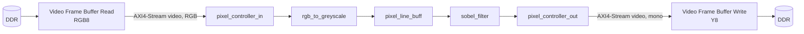

# Sobel Edge Detection on FPGA

A real-time Sobel edge detection pipeline in VHDL for the Avnet Ultra96-V2 (Zynq UltraScale+ ZU3EG). Frames are read from DDR as RGB video, converted to greyscale, filtered with a 3x3 Sobel operator, and written back to DDR as an 8-bit greyscale edge image, all over AXI4-Stream video at one pixel per clock.

**Status:** the full pipeline passes its system-level testbench, including random back-pressure, input gaps, back-to-back frames and resets. The block design builds a bitstream at 250 MHz with positive slack. Hardware bring-up under Linux is next.

## Pipeline



| Stage | Latency (clocks) | What it does |
|---|---|---|
| `pixel_controller_in` | 1 | AXI4-Stream video slave. Waits for a start of frame after reset, splits each beat into red, green and blue, and counts the pixel's x and y position. |
| `rgb_to_greyscale` | 1 | Weighted sum of red, green and blue with fixed-point gains, truncated to 8 bits. |
| `pixel_line_buff` | 2 | Two block RAM line buffers hold the previous two lines. A 3x3 shift register builds the window around each pixel. |
| `sobel_filter` | 2 | Horizontal and vertical Sobel convolution, then the magnitude as \|gx\| + \|gy\|, scaled to 8 bits. |
| `pixel_controller_out` | 1 | AXI4-Stream video master. Holds each beat until the downstream core accepts it. |

### Design notes

- **Back-pressure.** `pixel_controller_out` drives a single ready signal that is the clock enable for every stage, including the line buffer RAMs. When the frame buffer write core stalls, the whole pipeline holds, and no pixel is lost or repeated.
- **One output per input pixel.** Every input pixel produces exactly one output pixel, so frames keep their size and the start-of-frame (`tuser`) and end-of-line (`tlast`) markers stay on the right pixels. The first two rows and columns have no full 3x3 window and are output as black, which gives the edge image a two-pixel border.
- **Stream formats.** The input is 24-bit RGB in AXI4-Stream video order: red in the top byte, blue in the middle, green at the bottom. The output is the edge magnitude in the low byte of the stream, with the upper bytes zero, matching the frame buffer write core's Y8 format.
- **Shared constants.** Pixel width, window size and the Sobel kernels live in `scr/rtl/pkg_edge_detection.vhd`. The top level exposes only the frame width and the stream width as generics, because Vivado's block design can't read package constants. An assertion stops elaboration if the stream width generic disagrees with the package.

## Block design

The Vivado block design (`top_level`) connects:

- the Zynq UltraScale+ processor, configured from the Ultra96-V2 board preset
- a Video Frame Buffer Read core, RGB8 format, up to 1920 x 1080
- `top`, the pipeline, added as a module reference from `scr/rtl/top_edge_detection.vhd`
- a Video Frame Buffer Write core, Y8 format, up to 1920 x 1080

Both frame buffer cores reach DDR through the processor's `S_AXI_HPC0_FPD` port. Their control registers are reached through `M_AXI_HPM0_FPD`, and their interrupts go to the processor through `pl_ps_irq0`. Everything runs on one PL clock at 250 MHz.

### Timing at 250 MHz

| Check | Worst slack | Failing endpoints |
|---|---|---|
| Setup | 0.745 ns | 0 |
| Hold | 0.010 ns | 0 |
| Pulse width | 0.500 ns | 0 |

## Repository layout

```
scr/rtl/                 synthesizable VHDL: the five pipeline stages, the package and the top level
scr/tb/tb_top.sv         system-level testbench for the whole pipeline
scr/tb/                  older per-block testbenches (deprecated, kept for reference)
matlab_prototypes/       MATLAB prototypes and the test vector generator
vivado/create_project.tcl  recreates the Vivado project, including the block design
```

## Requirements

- Vivado 2022.2
- Ultra96-V2 board files from Avnet, version 1.2 (`avnet.com:ultra96v2:part0:1.2`)
- MATLAB with the Image Processing Toolbox, to generate test vectors

## Recreating the Vivado project

The project itself isn't committed. Recreate it from the script, running Vivado from inside `vivado/`, because the script finds the sources relative to the folder it's run from:

```
cd vivado
vivado -mode batch -source create_project.tcl
```

This creates the project in `vivado/edge_detection/`, which is ignored by git. Open `vivado/edge_detection/edge_detection.xpr` in Vivado to work on it.

After changing the project or the block design, export the script again before committing. In the Vivado Tcl console, with the project open:

```tcl
write_project_tcl -force <path to repository>/vivado/create_project.tcl
```

## Simulation

The system testbench `scr/tb/tb_top.sv` streams a frame through the pipeline and checks every output pixel against a MATLAB reference.

### 1. Generate the test vectors

Run `matlab_prototypes/top_level_test_vectors.m` from the `matlab_prototypes` folder. It models the hardware bit for bit, including the fixed-point greyscale, the Sobel kernels, the magnitude scaling and the black border, and writes:

- `top_level_in_test_vector.txt`: the input pixels, packed as AXI4-Stream RGB
- `top_level_out_test_vector.txt`: the expected output pixel at each position

Set `frame_width` and `frame_height` at the top of the script. A small frame, such as 64 x 48, runs in seconds. A full 1920 x 1080 frame takes several minutes per scenario. The testbench reads the frame size from the vectors, so it needs no change. The vector files are generated, so they're ignored by git.

### 2. Run the testbench

Set `tb_top` as the simulation top and run with `run all`. The vector file paths at the top of `tb_top.sv` are absolute, so adjust them for your checkout.

The check is pixel for pixel rather than clock for clock: for each output beat, the testbench counts the pixel's position, advancing to the next line on `tlast`, and compares the pixel value, position, `tuser` and `tlast` against the expected frame. Latency and stalls don't affect the result, only the order of the pixels. An assertion on the output also checks that a pixel waiting for `tready` stays valid and unchanged until it's taken.

| Scenario | What it tests |
|---|---|
| clean | One frame, no stalls |
| output back-pressure | The output's `tready` drops at random |
| input gaps | The input's `tvalid` drops at random between pixels |
| both | Random gaps and random back-pressure together |
| back to back | Two frames with no gap between them |
| back to back with gap | Two frames with idle clocks between them |
| mid-frame start | After reset, the end of a frame without its start; the pipeline must drop it and output only the following full frame |
| reset mid-frame | Half a frame, a reset, then a full frame |

A passing run ends with:

```
tb_top: PASS
```

## Next steps

- Bring up the design on the Ultra96-V2 under Linux: load a frame into DDR, run the frame buffer cores, and read back the edge image.
- Script the PetaLinux build alongside the Vivado project, so a fresh clone can rebuild the bitstream, the exported hardware and the Linux image.
